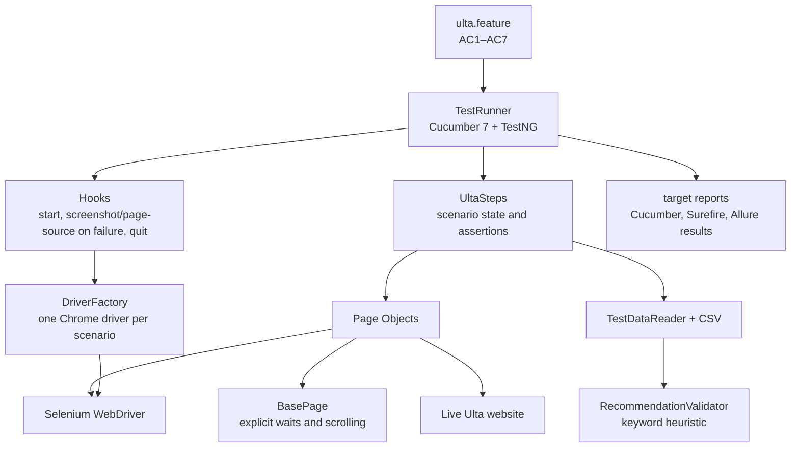

# Project Architecture, AI Evidence, and Prompts

## Purpose and scope

This document describes the framework structure, how the Ulta acceptance flow runs, where execution evidence is stored, and how AI-assisted test design and analysis are reviewed. The framework is an educational end-to-end test starter for AC1–AC7; it is not a production integration with Ulta and does not use a machine-learning recommendation model.

## Architecture



### Responsibilities

| Area | Responsibility |
|---|---|
| `src/test/resources/features/ulta.feature` | Single ordered Cucumber scenario carrying `@e2e` and `@AC1`–`@AC7`. |
| `src/test/java/com/ulta/runners/TestRunner.java` | TestNG/Cucumber entry point, glue registration, and Cucumber report plugins. Discovers the feature from `classpath:features`. |
| `hooks/Hooks.java` | Starts a browser before each scenario, attaches screenshot and page source on failure, and quits in a `finally`-safe cleanup. |
| `driver/DriverFactory.java` | Creates and manages the scenario's Chrome WebDriver. Supports the configured headless option. |
| `config/ConfigReader.java` and `src/test/resources/config/config.properties` | Loads base URL, browser, and explicit wait configuration. |
| `steps/UltaSteps.java` | Connects Gherkin steps to page operations; retains product titles, URLs, recommendation samples, and expected cart count across the scenario. |
| `pages/BasePage.java` | Shared explicit wait, visible/click/type, and scroll helpers. |
| `pages/HomePage.java`, `SearchResultsPage.java`, `ProductPage.java`, `BagPage.java` | Site interactions and candidate locators. Search/product navigation handles the live site's product-tab behavior; bag and recommendation elements are read from current page structure. |
| `utils/TestDataReader.java` and `utils/RecommendationValidator.java` | Reads CSV criteria and calculates title-keyword relevance using unrounded threshold comparisons. |
| `src/test/resources/testdata/ulta-test-data.csv` | Search inputs, relevance keyword sets, and AC5–AC7 thresholds. |
| `utils/RecommendationValidatorTest.java` | Focused unit coverage for recommendation scoring behavior. |

### Runtime flow

1. TestNG invokes the Cucumber runner; Cucumber loads `classpath:features/ulta.feature` and the configured steps/hooks.
2. The `@Before` hook starts one Chrome driver. The scenario validates homepage controls, searches the three product terms, adds products, and checks the bag in the same scenario/browser lifecycle.
3. Page objects contain site selectors and navigation behavior; explicit waits are used for client-rendered UI and add-to-bag confirmation.
4. Product-page and bag recommendation titles are collected from recommendation rails. The validator compares those visible titles to the configured CSV keyword sets.
5. The `@After` hook captures screenshot and page source if a step fails and always quits the driver. Maven/Surefire and Cucumber write reports beneath `target`.

The external Ulta site is live and can change its DOM, inventory, recommendation content, regional behavior, or access controls. CAPTCHA and other anti-bot controls must not be bypassed. A live-site limitation or content mismatch should be reported as observed; it should not be silently reclassified as an application defect.

## Acceptance criteria and scoring

| AC | Automated behavior | Threshold |
|---|---|---:|
| AC1 | Homepage search control is visible/enabled and account/sign-in control is accessible. | Assertion |
| AC2 | Search returns at least one product for moisturizer, mascara, and vitamin C serum. | Assertion |
| AC3 | Add one product for each term and verify the bag count reaches 1, 2, and 3. | Count checks |
| AC4 | Verify at least three bag products and confirm the titles of the products added by this scenario. | Bag content checks |
| AC5 | Score recommendations from the moisturizer PDP. | 30% |
| AC6 | Score recommendations on the bag using moisturizer- and mascara-related keywords. | 25% |
| AC7 | Score the combined PDP and bag recommendation sample. | 20% |

Recommendation scoring is a transparent keyword heuristic: a title is considered relevant when it contains at least one configured keyword. It is not an assessment of recommendation-model quality, ranking, or personalized intent. Empty samples score 0%; the pass/fail comparison uses the unrounded ratio. Validate keyword definitions and thresholds with the product owner before treating scores as product-quality evidence.

## AI-assisted workflow and evidence

AI is used to help draft and analyze test artifacts; the repository prompts require requirement traceability, explicit assumptions, and human review. The prompt files are the source of truth for the detailed instructions:

| Prompt artifact | Intended use | Review/evidence artifact |
|---|---|---|
| [`prompts/01_test_scenarios.md`](../prompts/01_test_scenarios.md) | Draft broad positive, negative, boundary, equivalence, UI, data-driven, recommendation, and end-to-end scenarios from the story and ACs. | [`docs/test-scenarios.xlsx`](test-scenarios.xlsx); check every scenario against the approved acceptance criteria. |
| [`prompts/02_qtest_cases.md`](../prompts/02_qtest_cases.md) | Convert reviewed cases to qTest-style one-row-per-step data. | [`docs/qtest-cases.xlsx`](qtest-cases.xlsx); verify field mapping against the target qTest import template. |
| [`prompts/03_automation.md`](../prompts/03_automation.md) | Constrain code-generation requests to the existing Java 17/Selenium/Cucumber/TestNG patterns and the approved AC scope. | Source code, build output, and test reports; review selectors and generated code before acceptance. |
| [`prompts/04_ai_result_analysis.md`](../prompts/04_ai_result_analysis.md) | Analyze Cucumber JSON totals and classify failures from observed evidence, with root causes labeled as hypotheses. | `target/cucumber.json`, cross-checked with `target/surefire-reports/` and `target/cucumber-report.html`. |

The prompt files guide the workflow; their presence alone is not evidence that a particular AI service was used, nor that all generated artifacts were independently approved. Record the actual reviewed output and execution report for each demonstration or release.

### Reusable evidence-grounded analysis prompt

Use the existing detailed analysis prompt in [`prompts/04_ai_result_analysis.md`](../prompts/04_ai_result_analysis.md). For an analysis that includes both automation design and execution results, use this expanded template:

> Act as a QA automation analyst. Analyze the supplied acceptance criteria, Cucumber JSON, Surefire summary, and any attached failure evidence. First map each AC to the implemented scenario steps. Then report test totals and pass/fail/skip counts, verifying totals against the raw reports. For each failed AC, quote the observed assertion or exception and identify the report file that supports it. Separate verified facts from hypotheses; do not infer an application defect from an automation, locator, environment, inventory, or live-site failure without evidence. For recommendation checks, include the actual visible titles, configured keyword set, threshold, and computed percentage. Identify missing evidence and propose focused follow-up investigations and regression checks. Do not modify thresholds or declare a pass to make the report appear successful.

### Latest recorded execution evidence

The latest test execution represented in `target/surefire-reports/TestSuite.txt` reports **5 tests, 1 failure, 0 errors, 0 skipped**. The end-to-end scenario completed the search, add-to-bag, bag-content, and AC5 checks. AC6 failed: **0% relevance against the 25% minimum**, based on eight visible bag recommendation titles. AC7 was evaluated and passed. The failure text and titles are in `target/surefire-reports/TestSuite.txt`; the complete browser report is `target/cucumber-report.html` and the raw Cucumber event stream is `target/cucumber.json` when present.

These reports are generated outputs and are overwritten by later test runs. Treat the summary above as evidence only for the run that produced the current files. For durable review evidence, archive the raw JSON, Surefire summary, Cucumber HTML, and failure screenshot/page source together with a run timestamp and environment details.

## Run and inspect

From the project root in PowerShell:

```powershell
.\mvnw.cmd clean test '-Dcucumber.filter.tags=@e2e'
```

Inspect `target/cucumber-report.html`, `target/cucumber.json`, `target/surefire-reports/`, and `target/allure-results/` after the run. Allure HTML generation requires a compatible Allure CLI. In IntelliJ, use the Cucumber run configuration scoped to `src/test/resources/features` or run the TestNG `TestRunner`; scanning the whole project root can discover both the source feature and Maven's copied feature under `target/test-classes`.
